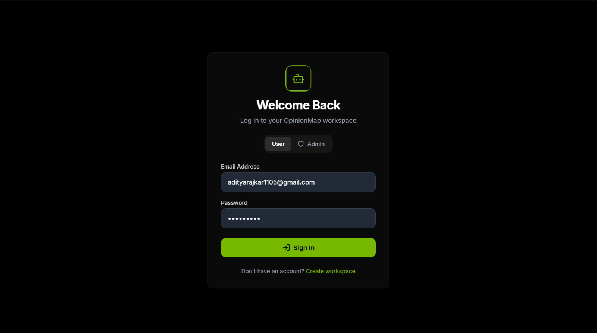
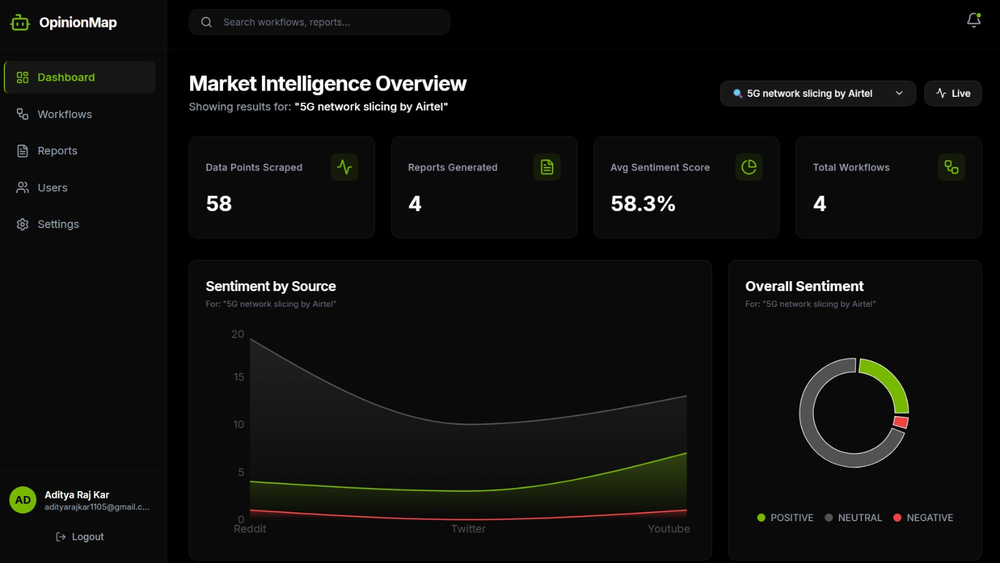
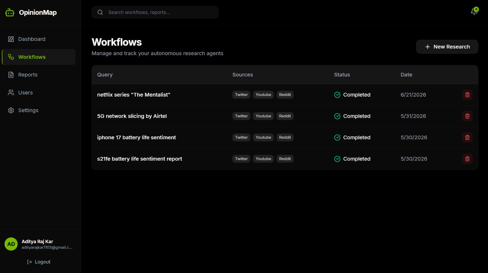
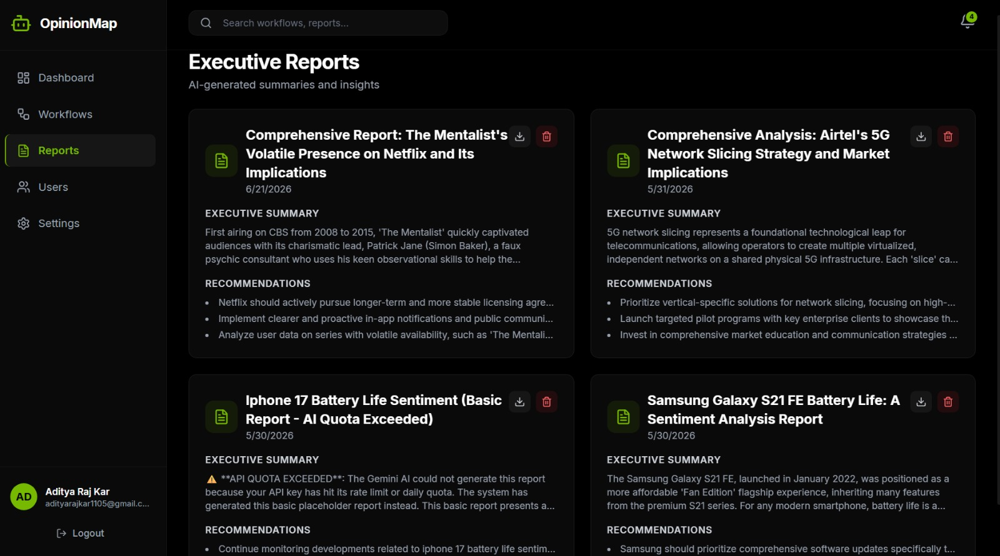
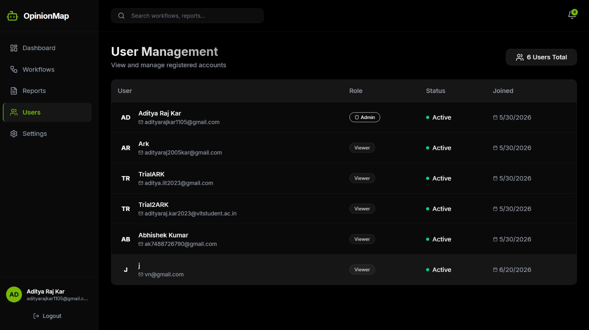
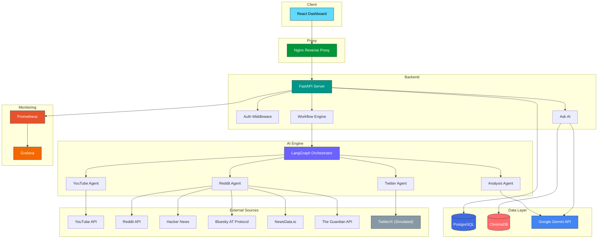

<div align="center">

# OpinionMap

### Multi-Agent Market Intelligence Platform

[](https://python.org)
[](https://fastapi.tiangolo.com)
[](https://react.dev)
[](https://typescriptlang.org)
[](https://docker.com)
[](https://postgresql.org)
[](LICENSE)

*Production-grade AI platform that orchestrates intelligent agents to gather, analyze, and deliver real-time market intelligence from multiple data sources.*

---

[**Features**](#-features) · [**Quick Start**](#-quick-start) · [**Architecture**](#-architecture) · [**API Docs**](#-api-documentation) · [**Contributing**](#-contributing)

</div>

---

## About

**OpinionMap** is a production-grade, multi-agent market intelligence platform that leverages cutting-edge AI orchestration to provide comprehensive market analysis. Built with **LangGraph** for sophisticated agent workflow management and powered by **Google Gemini**, the platform autonomously scrapes, processes, and analyzes data from YouTube and Reddit (with a Twitter/X sentiment simulator for demo purposes).

Once a run completes, **Ask AI** lets you question its data directly: **Retrieval-Augmented Generation (RAG)** over ChromaDB answers follow-up questions from the collected comments only, cites the exact comments it used, and says so when the data doesn't cover a question. A **React + TypeScript** dashboard provides interactive visualizations, while **Prometheus + Grafana** deliver real-time observability.

Whether you're tracking competitor movements, analyzing market sentiment, or discovering emerging trends — OpinionMap provides the intelligence you need, when you need it.

**Live Application:** https://opinionmap.netlify.app
---

## Screenshots

<div align="center">

## Authentication


## Dashboard


## Workflow Management


## Reports


## User Management


</div>

---

## Features

- 🤖 **Multi-Agent Orchestration** — LangGraph-powered agent workflows with dynamic task routing and parallel execution
- 📊 **Multi-Source Intelligence** — YouTube, Reddit, Hacker News, and Bluesky scraping with NewsData.io and The Guardian for journalism coverage; Twitter/X uses a local sentiment simulator. All sources fall back to realistic demo data — no API keys required to run the full pipeline.
- 💬 **Ask AI** — Question the data, not just the summary. Every completed workflow is embedded into its own ChromaDB collection; follow-up questions get answers built only from the collected comments, each claim cited to the exact comment, with a plain "not covered" when the data doesn't answer it. Simulated sources are flagged on every citation.
- 🎨 **Interactive Dashboard** — React + TypeScript UI with real-time data visualization and workflow management
- 🔄 **Workflow Management** — Create, monitor, and control complex multi-agent analysis pipelines
- 📈 **Comprehensive Monitoring** — Prometheus metrics, Grafana dashboards, and structured logging
- 🔐 **Enterprise Security** — JWT authentication, rate limiting, CORS, and security headers
- 🐳 **One-Command Deployment** — Full Docker Compose stack with health checks and auto-restart

---

## Tech Stack

| Layer | Technology |
|:---|:---|
| **Backend** | Python 3.11 · FastAPI · SQLAlchemy · Alembic · Pydantic |
| **Frontend** | React 19 · TypeScript · Vite · React Router · Axios · Recharts · Tailwind CSS |
| **AI / ML** | Google Gemini · LangGraph · ChromaDB (RAG) |
| **Database** | PostgreSQL 16 · ChromaDB (Vector Store) |
| **Monitoring** | Prometheus · Grafana · Structured Logging |
| **DevOps** | Docker · Docker Compose · Nginx · Makefile |

---

## Architecture



---

## Quick Start

### Prerequisites
- **Docker** and **Docker Compose**
- **Git**

### Data Sources & Demo Mode

OpinionMap can run in two modes depending on which API credentials are configured:

**Live mode** — YouTube and Reddit return real scraped data when valid API keys are provided (`YOUTUBE_API_KEY`, `REDDIT_CLIENT_ID`, `REDDIT_CLIENT_SECRET`) and `DEBUG=false` is set in your `.env`.

**Demo mode** — All three data sources (YouTube, Reddit, and Twitter/X) return realistic synthetic data generated locally. This mode activates when `DEBUG=true` or when API credentials are missing or invalid. The default `.env.example` ships with `DEBUG=true`, so a fresh Quick Start runs entirely in demo mode — no API keys required to see the full pipeline in action.

> **Note on Twitter/X:** Twitter's API requires a paid developer plan. The Twitter/X source in OpinionMap always uses a local synthetic data generator, regardless of `DEBUG` mode. This is clearly marked in `backend/app/scrapers/twitter.py`.

Demo mode is intentional — it lets you run and demo the full multi-agent pipeline end-to-end without external API dependencies. To switch to live data, set `DEBUG=false` and add your API keys to `.env`.

### 1. Environment Setup
```bash
# Clone the repository (if you haven't already)
git clone https://github.com/yourusername/OpinionMap.git
cd OpinionMap

# Copy the environment file
cp .env.example .env

# IMPORTANT: Edit .env and securely generate new passwords and JWT keys!
```

### 2. SSL Certificates
The platform is secured with HTTPS by default. Generate self-signed certs (or place your real domain certs in `nginx/ssl/`):
```bash
docker run --rm -v $(pwd)/nginx/ssl:/ssl alpine/openssl req -x509 -nodes -days 365 -newkey rsa:2048 -keyout /ssl/privkey.pem -out /ssl/fullchain.pem -subj "/C=US/ST=State/L=City/O=OpinionMap/CN=localhost"
```
> `nginx/ssl/*.pem` is gitignored and intentionally **not** committed — every deployment generates its own certificates with the command above.

### 3. Deploy
Deploy the entire secure stack using Docker Compose:
```bash
docker compose up -d --build
```
Your secure deployment will now be running and accessible at `https://localhost` (or your public domain).

### Hosted Deployment (Netlify + Render)

- **Frontend (Netlify):** set `VITE_API_URL` to the backend's `/api` URL at build time.
- **Backend (Render):** set `JWT_SECRET_KEY` to a random value. The app logs a warning at startup
  if it is still the built-in default. Set `CORS_ORIGINS` to include the Netlify URL.
- **Keep the free tier awake:** a free Render instance sleeps after about 15 minutes idle, and the
  first request afterwards has been measured at more than 90 seconds, which is what makes the first
  login slow. Point an uptime monitor (UptimeRobot, Better Stack, cron-job.org) at `GET` or `HEAD`
  `https://<your-backend>/`, every 10–14 minutes. That endpoint does no database or auth work.
  One always-on free service stays within Render's monthly free-instance hours.
- **Ask AI on Render:** with `CHROMA_HOST` unset the vectors live on the instance's local disk,
  which Render wipes on every restart and deploy. Nothing is lost: Postgres stays the source of
  truth, and a workflow's collection is rebuilt from its stored comments on the next question
  (the page shows progress meanwhile). The free Gemini tier embeds 100 texts a minute and 1,000 a
  day, roughly 3–6 workflows; set `ASK_AI_INDEX_ON_COMPLETE=false` to embed only workflows someone
  asks about. The other `ASK_AI_*` settings are described in `.env.example`.
- **Password hashing cost:** `BCRYPT_ROUNDS` (default 12, allowed 10–15). Each step doubles the CPU
  time of every login. Existing users are re-hashed at the new cost on their next login, so it can
  be changed at any time.

### Local Development (Using Make)

```bash
make setup    # Initial setup
make dev      # Start development environment
make test     # Run tests
make logs     # Follow Docker logs
```

---

## API Documentation

OpinionMap provides interactive API documentation:

- **Swagger UI**: `/docs` (Available when running locally at `http://localhost:8000/docs`)
- **ReDoc**: `/redoc` (Available when running locally at `http://localhost:8000/redoc`)

### Key Endpoints

| Method | Endpoint | Description |
|:---|:---|:---|
| `POST` | `/api/auth/register` | Register a new user account |
| `POST` | `/api/auth/login` | Authenticate and receive JWT token |
| `GET` | `/api/auth/me` | Current user's profile |
| `GET` | `/api/auth/users` | List users (admin only) |
| `POST` | `/api/workflows/` | Create and run a new analysis workflow |
| `GET` | `/api/workflows/` | List all workflows for the current user |
| `GET` | `/api/workflows/{id}` | Get workflow status and results |
| `DELETE` | `/api/workflows/{id}` | Delete a workflow and its data |
| `GET` | `/api/reports/` | List all generated reports |
| `GET` | `/api/reports/{id}/export/pdf` | Download a report as PDF |
| `GET` | `/api/reports/{id}/export/docx` | Download a report as DOCX |
| `GET` | `/api/dashboard/overview` | Dashboard summary metrics |
| `GET` | `/api/dashboard/sentiment` | Sentiment breakdown data |
| `GET` | `/api/dashboard/trends` | Trend time-series data |
| `GET` | `/api/workflows/{id}/ask/status` | Ask AI: is the workflow's data indexed, and how much is simulated |
| `POST` | `/api/workflows/{id}/ask` | Ask AI: a cited answer from the workflow's comments (202 while its data is being prepared) |
| `POST` | `/api/rag/query` | Legacy uncited RAG query over one owned workflow (superseded by Ask AI) |
| `GET` | `/api/schedules/` | List scheduled tasks |
| `GET` | `/api/monitoring/health` | Health check (verifies DB connectivity) |
| `GET` | `/metrics` | Prometheus scrape endpoint |
| `GET` | `/` | Root / liveness check |

---

## Project Structure

```
OpinionMap/
├── backend/                    # FastAPI Backend
│   ├── alembic/               # Database migrations
│   │   ├── versions/          # Migration files
│   │   ├── env.py             # Alembic environment config
│   │   └── script.py.mako     # Migration template
│   ├── app/
│   │   ├── agents/            # LangGraph agent definitions
│   │   ├── api/               # API route handlers
│   │   ├── core/              # Config, security, dependencies
│   │   ├── models/            # SQLAlchemy ORM models
│   │   ├── rag/               # Ask AI: embeddings, Chroma store, per-workflow index
│   │   ├── schemas/           # Pydantic request/response schemas
│   │   ├── services/          # Business logic layer
│   │   ├── database.py        # Database connection setup
│   │   └── main.py            # FastAPI application entry
│   ├── tests/                 # pytest suite (auth, Ask AI)
│   ├── alembic.ini            # Alembic configuration
│   ├── Dockerfile             # Backend container
│   └── requirements.txt       # Python dependencies
├── frontend/                   # React Frontend
│   ├── src/
│   │   ├── api/               # API client and service functions
│   │   ├── assets/            # Static assets
│   │   ├── components/        # Reusable UI components
│   │   ├── context/           # React context providers
│   │   ├── features/ask-ai/   # Ask AI page (lazy-loaded, own CSS)
│   │   ├── landing/           # Public landing page (lazy-loaded)
│   │   └── pages/             # Page components
│   ├── Dockerfile             # Frontend container
│   ├── nginx.conf             # Frontend Nginx config
│   └── package.json           # Node dependencies
├── monitoring/                 # Observability Stack
│   ├── grafana/
│   │   └── dashboards/        # Grafana dashboard configs
│   └── prometheus/
│       └── prometheus.yml     # Prometheus scrape config
├── nginx/                      # Reverse Proxy
│   └── nginx.conf             # Main Nginx configuration
├── .env.example               # Environment variable template
├── .gitignore                 # Git ignore rules
├── docker-compose.yml         # Docker Compose orchestration
├── Makefile                   # Development commands
└── README.md                  # This file
```

> **Note on tests:** `backend/tests/` covers authentication (login, registration, user listing) and Ask AI (ownership, validation, the not-covered gate, citation checks, prompt-injection handling, rate limiting, rebuilding from Postgres, and that indexing failures never change a workflow's status). Embeddings and Gemini are faked, so no network is needed. It runs with `make test` or `cd backend && pytest` against a throwaway SQLite database. `make test-cov`, `make format` and `make lint` still print a notice instead of running anything (pytest-cov, black, isort, ruff and mypy are intentionally not runtime dependencies).

---

## Contributing

We welcome contributions! Here's how to get started:

1. **Fork** the repository
2. **Create** a feature branch: `git checkout -b feature/amazing-feature`
3. **Commit** your changes: `git commit -m 'feat: add amazing feature'`
4. **Push** to the branch: `git push origin feature/amazing-feature`
5. **Open** a Pull Request

### Development Guidelines

- Follow [Conventional Commits](https://www.conventionalcommits.org/)
- Write tests for new features
- Run `make format` and `make lint` before committing
- Update documentation as needed

---

## License

This project is licensed under the **MIT License** — see the [LICENSE](LICENSE) file for details.

---

<div align="center">

**Built with ❤️ by TRITUSLegend**

[⬆ Back to Top](#-OpinionMap-ai)

</div>
