<div align="center">

# OpinionMap

### Multi-Agent Market Intelligence Platform

[](https://python.org)
[](https://fastapi.tiangolo.com)
[](https://react.dev)
[](https://typescriptlang.org)
[](https://docker.com)
[](https://postgresql.org)
[](LICENSE)

*Type a topic: a six-step agent pipeline gathers public opinion from seven sources, analyses it and writes a report. Then ask follow-up questions answered from the collected comments, with citations.*

---

[**Features**](#features) · [**Quick Start**](#quick-start) · [**Architecture**](#architecture) · [**API Docs**](#api-documentation) · [**Known Issues**](#known-issues) · [**Contributing**](#contributing)

</div>

---

## About

**OpinionMap** is a multi-agent opinion-research platform. A six-node **LangGraph** pipeline collects posts, comments and articles from seven sources: Hacker News, Reddit, YouTube, Bluesky, NewsData.io, The Guardian, and Twitter/X, which is always simulated. It cleans and de-duplicates them and scores sentiment with a simple word-list heuristic. **Google Gemini** then interprets the patterns and writes a report, which a deterministic quality check approves or sends back for a rewrite.

Once a run completes, **Ask AI** lets you question its data directly. **Retrieval-Augmented Generation (RAG)** over ChromaDB answers follow-up questions from that workflow's collected comments only, cites the exact comments it used, and says so when the data doesn't cover a question. A **React + TypeScript** single-page app provides the public landing page, the dashboard, workflow management and reports. The backend exposes Prometheus metrics and structured JSON logs.

**Live Application:** https://opinionmap.netlify.app
---

## Screenshots

### Landing

<p align="center">
  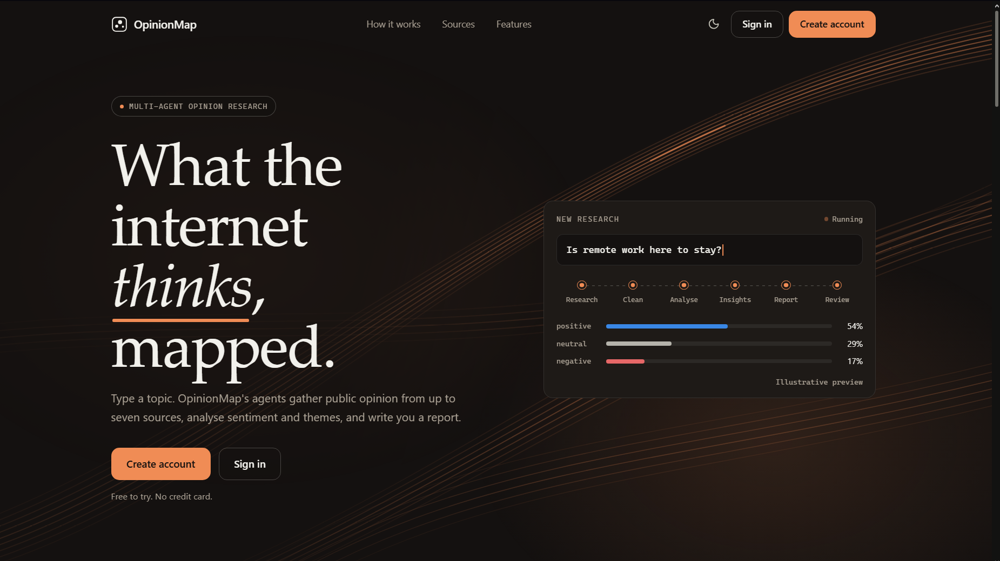
  <br>
  <em>The public landing page. Sign in or create an account to start.</em>
</p>

<p align="center">
  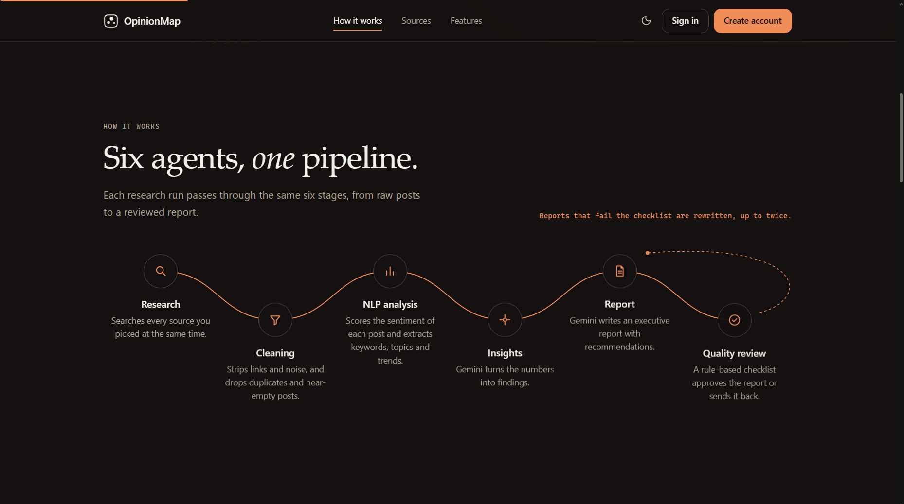
  <br>
  <em>The six-stage pipeline: research, cleaning, NLP analysis, insights, report, review.</em>
</p>

### Sign in

<p align="center">
  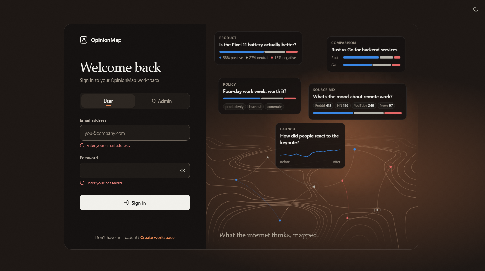
  <br>
  <em>Split-card login with the topographic scene. Hovering a sentiment colour highlights every matching element.</em>
</p>

### Workflows

<table>
  <tr>
    <td align="center" width="50%">
      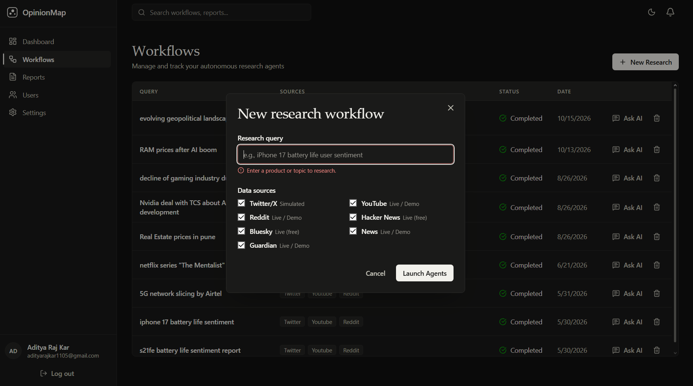
      <br>
      <em>Start a run: enter a topic and choose from 7 sources.</em>
    </td>
    <td align="center" width="50%">
      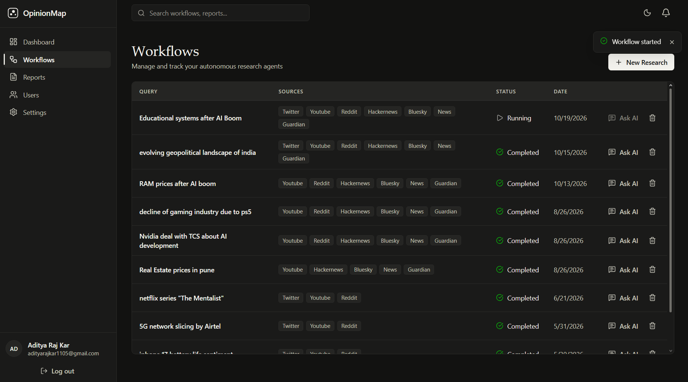
      <br>
      <em>Track runs by status and open Ask AI for completed ones.</em>
    </td>
  </tr>
</table>

### Dashboard and reports

<p align="center">
  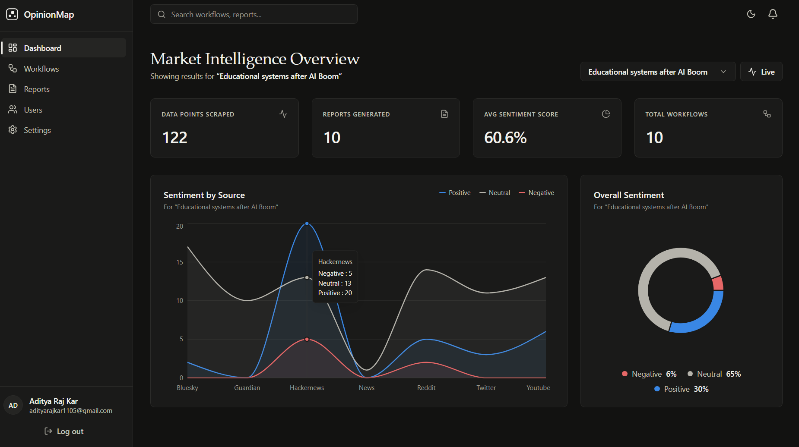
  <br>
  <em>Sentiment by source, sentiment split and headline metrics for a completed workflow.</em>
</p>

<p align="center">
  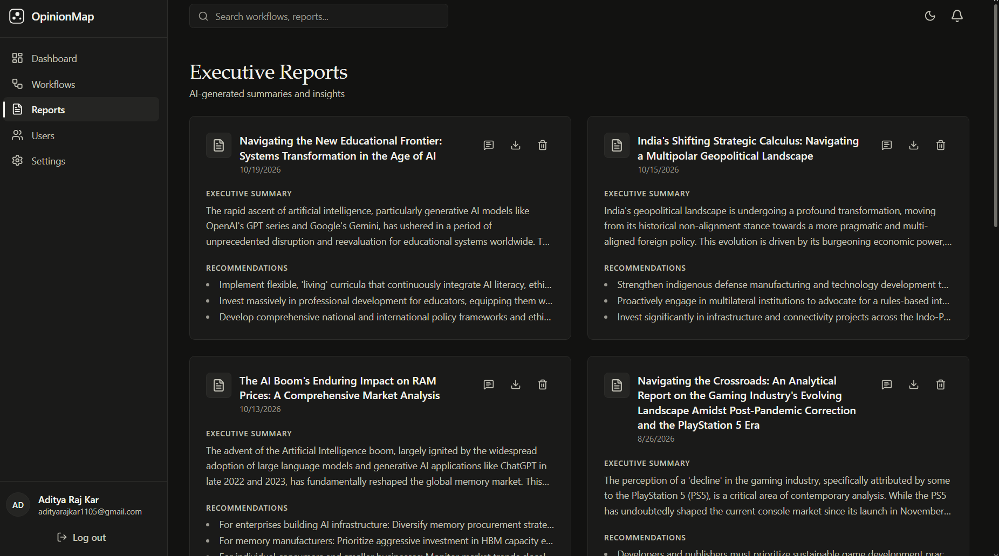
  <br>
  <em>Generated reports, each downloadable as PDF.</em>
</p>

### Ask AI

<table>
  <tr>
    <td align="center" width="50%">
      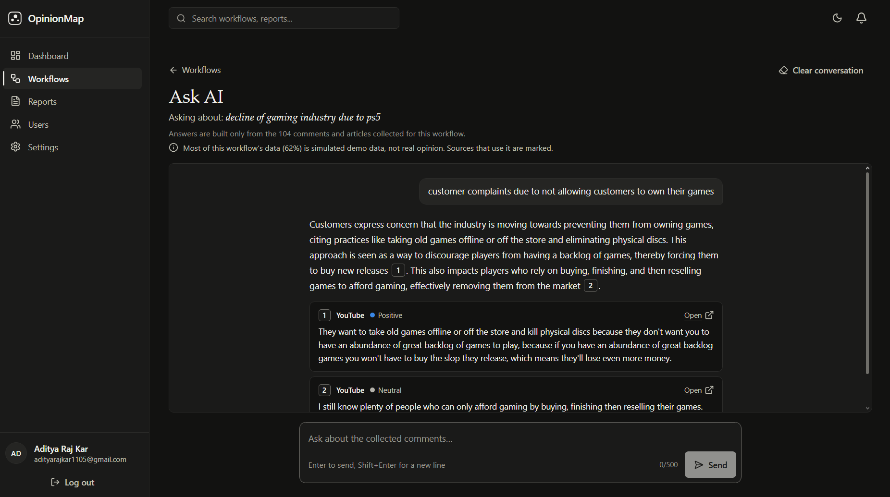
      <br>
      <em>Answers cite the exact source comments.</em>
    </td>
    <td align="center" width="50%">
      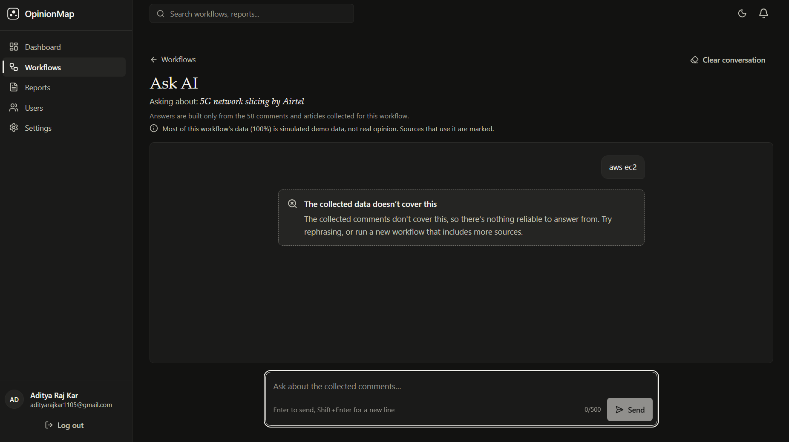
      <br>
      <em>When the data doesn't cover a question, it says so instead of guessing.</em>
    </td>
  </tr>
</table>

### Themes

<table>
  <tr>
    <td align="center" width="50%">
      
      <br>
      <em>Dark theme</em>
    </td>
    <td align="center" width="50%">
      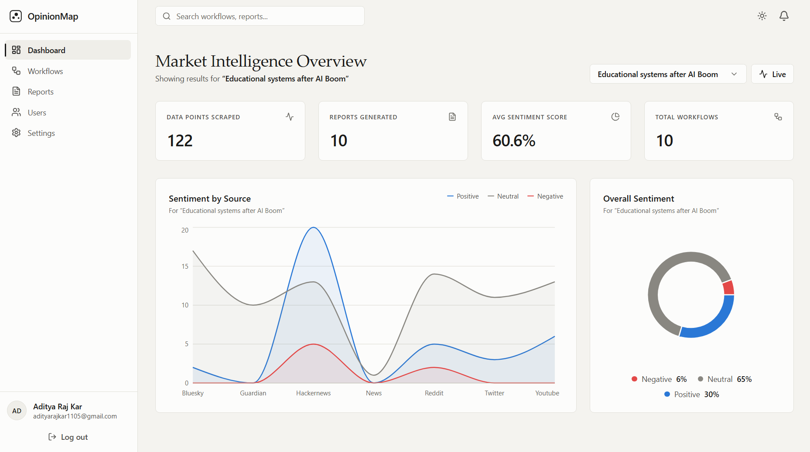
      <br>
      <em>Light theme</em>
    </td>
  </tr>
</table>

---

## Features

- 🤖 **Agent Pipeline** — Six LangGraph nodes in a fixed order: `research → cleaning → nlp_analysis → insights → report → reviewer`. The reviewer is a deterministic quality check. It can send the report back for a rewrite, and on the third report pass it force-approves the run as `auto_approved`. Sources are scraped concurrently inside the research node.
- 📊 **Seven Sources** — Hacker News, Reddit, YouTube, Bluesky, NewsData.io and The Guardian, plus Twitter/X, which is always simulated. Any source falls back to template "demo" data when its credentials are missing, its API fails or it returns nothing. The pipeline therefore runs end to end with no API keys, but the results can be partly or entirely synthetic.
- 💬 **Ask AI** — Question the data, not just the summary. By default every completed workflow is embedded into its own ChromaDB collection. Follow-up questions get answers built only from the collected comments, with each claim cited to the exact comment, and a plain "not covered" when the data doesn't answer it. Citations from simulated data are flagged.
- 🎨 **Dashboard** — Sentiment charts for one completed workflow at a time. Data is loaded when the page opens; there are no live updates.
- 🔄 **Workflow Management** — Start, list, delete and track runs. The Workflows list polls every 15 seconds, and reports download as PDF.
- 🌐 **Public landing page** at `/`. The signed-in app lives at `/dashboard`, `/workflows`, `/reports` and `/workflows/:id/ask`.
- 📈 **Monitoring** — Prometheus metrics at `/metrics` and structured JSON logs (structlog). Docker Compose also ships Prometheus and Grafana, but their configuration doesn't match the app yet (see [Known Issues](#known-issues)).
- 🔐 **Security** — JWT authentication with bcrypt, identical 401s for every login failure, an admin-only user list, prompt-injection screening and CORS. In the Docker Compose deployment, nginx adds TLS, per-IP rate limits and security headers.
- 🐳 **Docker Compose** — A seven-service stack with health checks and auto-restart. It needs TLS certificates and Postgres credentials (see Quick Start).

---

## Tech Stack

| Layer | Technology |
|:---|:---|
| **Backend** | Python 3.11 (Docker image) · FastAPI · SQLAlchemy 2 (async) · Pydantic · Alembic (configured, no migrations yet). Python dependencies are unpinned in `backend/requirements.txt` |
| **Frontend** | React 19 · TypeScript 6 · Vite 8 · React Router 6 · Axios · Recharts 3 · Tailwind CSS 4 · GSAP (dashboard only) |
| **AI / ML** | Google Gemini (`gemini-2.5-flash` for text, `gemini-embedding-001` for embeddings) via the deprecated `google-generativeai` SDK · LangGraph · ChromaDB (RAG) |
| **Database** | PostgreSQL 16 (SQLite fallback for local dev) · ChromaDB (vector store) |
| **Monitoring** | prometheus-client · structlog · Prometheus and Grafana containers in Compose |
| **DevOps** | Docker Compose · Nginx · Makefile · Netlify (frontend) + Render (backend) |

---

## Architecture

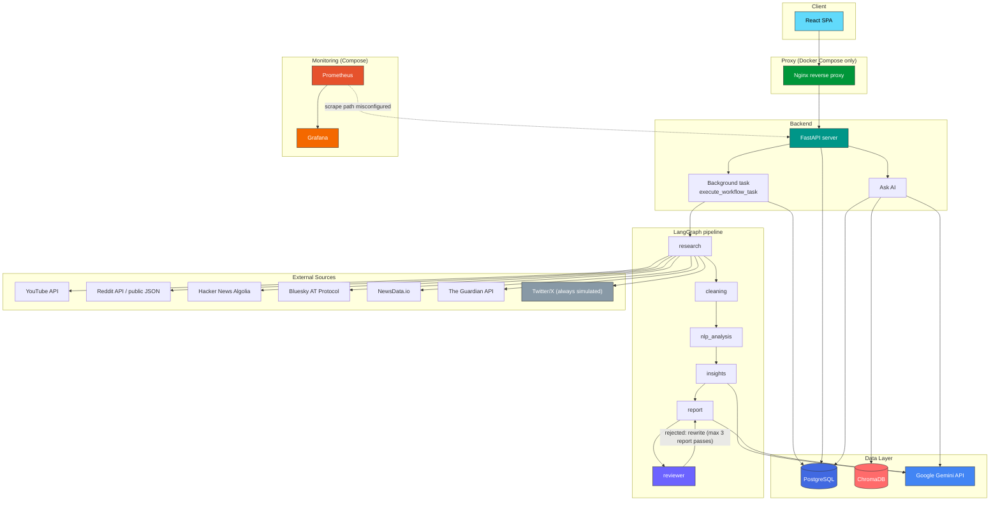

---

## Quick Start

### Prerequisites
- **Docker** and **Docker Compose**
- **Git**

### Data Sources & Demo Data

There is no global demo switch. Each of the seven sources decides on every run whether it returns live or template ("demo") data:

| Source | Live when | Falls back to template data when |
|:---|:---|:---|
| Twitter/X | never: `backend/app/scrapers/twitter.py` has no live code path | always |
| Hacker News | always tried (public Algolia API, no key) | the API errors or returns no results |
| Bluesky | `BLUESKY_IDENTIFIER` + `BLUESKY_APP_PASSWORD` are set (the unauthenticated search endpoint usually returns 403) | no credentials, an error, or no results |
| NewsData.io | `NEWSDATA_API_KEY` is set | no key, an error, or no results |
| The Guardian | `GUARDIAN_API_KEY` is set | no key, an error, or no results |
| YouTube | `YOUTUBE_API_KEY` is set and `DEBUG=false` | no key, `DEBUG=true`, an error, or no videos or comments |
| Reddit | PRAW with `REDDIT_CLIENT_ID` + `REDDIT_CLIENT_SECRET`; otherwise Reddit's keyless public JSON search | both fail or return nothing (`DEBUG=true` skips PRAW) |

`.env.example` ships with `DEBUG=false`. The fallbacks are silent apart from a log line, and template rows are stored exactly like real ones. Only Ask AI recognises them and flags them as "Simulated". Without `GEMINI_API_KEY`, the insights and report steps also fall back to local templates, and the report is titled "… (Basic Report - AI Quota Exceeded)" even though no quota was involved.

> **Note on Twitter/X:** Twitter's API requires a paid developer plan, so the Twitter/X source always generates synthetic posts from templates. The file's docstring says so, and the new-workflow form labels it "Simulated".

### 1. Environment Setup
```bash
# Clone the repository (if you haven't already)
git clone https://github.com/yourusername/OpinionMap.git
cd OpinionMap

# Copy the environment file
cp .env.example .env

# IMPORTANT: Edit .env and securely generate new passwords and JWT keys!
```

For Docker Compose, `.env` must define `POSTGRES_USER`, `POSTGRES_PASSWORD` and `POSTGRES_DB`. The `postgres` service and the backend's `DATABASE_URL` are both built from them. The Postgres health check in `docker-compose.yml` is hardcoded to user and database `agentflow`, which matches the `.env.example` values.

### 2. SSL Certificates
The platform is secured with HTTPS by default. Generate self-signed certs (or place your real domain certs in `nginx/ssl/`):
```bash
docker run --rm -v $(pwd)/nginx/ssl:/ssl alpine/openssl req -x509 -nodes -days 365 -newkey rsa:2048 -keyout /ssl/privkey.pem -out /ssl/fullchain.pem -subj "/C=US/ST=State/L=City/O=OpinionMap/CN=localhost"
```
> `nginx/ssl/*.pem` is gitignored and intentionally **not** committed — every deployment generates its own certificates with the command above.

### 3. Deploy
Deploy the entire secure stack using Docker Compose:
```bash
docker compose up -d --build
```
Your secure deployment will now be running and accessible at `https://localhost` (or your public domain).

### Hosted Deployment (Netlify + Render)

- **Frontend (Netlify):** set `VITE_API_URL` to the backend's `/api` URL at build time.
- **Backend (Render):** set `JWT_SECRET_KEY` to a random value. The app logs a warning at startup
  if it is still the built-in default.
- **CORS:** set `CORS_ORIGINS` to include the Netlify URL. This setting is **not** in
  `.env.example`. It must be a **JSON array**, for example
  `CORS_ORIGINS=["https://<your-site>.netlify.app"]`. A comma-separated value fails settings
  validation and the app does not start. The default is
  `["http://localhost","http://localhost:3000","https://localhost"]`.
- **Token lifetime:** `ACCESS_TOKEN_EXPIRE_MINUTES` (code default 480, i.e. 8 hours). There is no
  refresh token, so users sign in again when it expires.
- **Keep the free tier awake:** a free Render instance sleeps when idle. The first request after
  that was measured at more than 90 seconds on 2026-10-12 (`docs/CHANGE_PLAN.md`; not re-measured
  since), which is what makes the first login slow. The frontend waits up to 90 s on auth requests
  and pings `/api/monitoring/health` from the login, signup and landing pages to start the wake-up
  early. Point an uptime monitor at `GET` or `HEAD` `https://<your-backend>/` every 10–14 minutes.
  That endpoint does no database or auth work. (Render's exact idle timeout and free-hour limits
  are platform details, unverified here.)
- **Ask AI on Render:** with `CHROMA_HOST` unset the vectors live on the instance's local disk,
  which Render wipes on every restart and deploy. Nothing is lost: Postgres stays the source of
  truth, and a workflow's collection is rebuilt from its stored comments on the next question
  (the page shows progress meanwhile). During development the free Gemini tier allowed 100
  embedding texts a minute and 1,000 a day, roughly 3–6 workflows (`docs/ASK_AI_PLAN.md`; quotas
  can change). Set `ASK_AI_INDEX_ON_COMPLETE=false` to embed only workflows someone asks about. The
  other `ASK_AI_*` settings are listed under [Configuration](#configuration).
- **Password hashing cost:** `BCRYPT_ROUNDS` (default 12, allowed 10–15). Each step doubles the CPU
  time of every login. Existing users are re-hashed at the new cost on their next login, so it can
  be changed at any time.

### Local Development (Using Make)

```bash
make setup    # Copy .env.example to .env (if missing), install backend and frontend dependencies
make dev      # Start postgres + chromadb containers, the backend (uvicorn --reload) and the Vite dev server
make test     # Run the backend pytest suite
make logs     # Follow Docker logs
```

> **`make dev` uses SQLite, not the Postgres container.** The backend is started from `backend/`,
> and settings read `.env` relative to the current working directory. There is no `backend/.env`,
> so that process loads no `.env` file. It falls back to SQLite (`backend/agentflow.db`) and the
> code defaults for every setting, including no `GEMINI_API_KEY`. Export `DATABASE_URL` and any
> keys in your shell first if you want them. The Vite dev server proxies `/api` to
> `http://localhost:8000`.

---

## Configuration

All settings are environment variables read by `backend/app/config.py`, from the process
environment plus a `.env` file in the **current working directory**. `.env.example` lists them with
placeholder values. Only names and code defaults are shown here.

| Variable | Code default | Purpose |
|:---|:---|:---|
| `DATABASE_URL` | `sqlite+aiosqlite:///./agentflow.db` | Async SQLAlchemy URL. Compose sets a Postgres URL |
| `JWT_SECRET_KEY` | built-in placeholder (startup warns) | Token signing secret. Always set it |
| `ACCESS_TOKEN_EXPIRE_MINUTES` | `480` | Token lifetime |
| `BCRYPT_ROUNDS` | `12` (allowed 10–15) | Password hash cost. Existing hashes are upgraded on the next login |
| `GEMINI_API_KEY` | empty | Gemini text and embeddings. Without it, reports use templates and Ask AI returns 503 |
| `CORS_ORIGINS` | `["http://localhost","http://localhost:3000","https://localhost"]` | Allowed browser origins. Must be a JSON array. Not in `.env.example` |
| `DEBUG` | `false` | SQL echo; forces YouTube to template data and makes Reddit skip PRAW |
| Source credentials | empty | `YOUTUBE_API_KEY`, `REDDIT_CLIENT_ID`, `REDDIT_CLIENT_SECRET`, `REDDIT_USER_AGENT`, `NEWSDATA_API_KEY`, `GUARDIAN_API_KEY`, `BLUESKY_IDENTIFIER`, `BLUESKY_APP_PASSWORD` |

**Ask AI settings**

| Variable | Code default | Purpose |
|:---|:---|:---|
| `CHROMA_HOST` / `CHROMA_PORT` | empty / `8000` | Chroma server. Empty host means a local on-disk store. Compose sets `chromadb` |
| `CHROMA_PERSIST_DIR` | `./chroma_data` | Local on-disk vector store |
| `EMBEDDING_MODEL` | `models/gemini-embedding-001` | Embedding model |
| `EMBEDDING_DIM` | `768` | Vector size |
| `EMBEDDING_BATCH_SIZE` | `50` | Texts per embedding request |
| `ASK_AI_TOP_K` | `8` | Excerpts retrieved per question |
| `ASK_AI_MIN_SIMILARITY` | `0.6` | Best cosine similarity needed before Gemini is called at all |
| `ASK_AI_MAX_CHUNKS` | `400` | Max chunks embedded per workflow |
| `ASK_AI_INDEX_WAIT_SECONDS` | `25` | How long a question waits for a missing index before answering 202 "preparing" |
| `ASK_AI_INDEX_ON_COMPLETE` | `true` | Embed each workflow when its run completes. `false` means on its first question |
| `ASK_AI_RATE_LIMIT_PER_MINUTE` | `10` | Questions per user per minute (in memory, per process) |

`POSTGRES_USER`, `POSTGRES_PASSWORD`, `POSTGRES_DB` and `GRAFANA_ADMIN_PASSWORD` are used by Docker
Compose, not by the app. `PROMETHEUS_PORT` appears in `.env.example` but nothing reads it.

### Frontend Routes

| Path | Access |
|:---|:---|
| `/` | Public landing page (its own lazy-loaded chunk) |
| `/login`, `/signup` | Public |
| `/dashboard` | Signed in (lazy-loaded chunk with the charts) |
| `/workflows` | Signed in |
| `/workflows/:workflowId/ask` | Signed in; Ask AI (lazy-loaded chunk) |
| `/reports`, `/settings` | Signed in |
| `/users` | Signed in, admin role only |

Any other path redirects to `/`. A 401 from the API outside the login and signup forms clears the
session and redirects to `/login?session=expired`.

---

## API Documentation

OpinionMap provides interactive API documentation:

- **Swagger UI**: `/docs` (Available when running locally at `http://localhost:8000/docs`)
- **ReDoc**: `/redoc` (Available when running locally at `http://localhost:8000/redoc`)

### Key Endpoints

| Method | Endpoint | Description |
|:---|:---|:---|
| `POST` | `/api/auth/register` | Register a new user account |
| `POST` | `/api/auth/login` | Authenticate and receive JWT token |
| `POST` | `/api/auth/admin-login` | Same, but 403 for a valid non-admin account |
| `GET` | `/api/auth/me` | Current user's profile |
| `GET` | `/api/auth/users` | List users (admin only) |
| `POST` | `/api/workflows/` | Create and run a new analysis workflow |
| `GET` | `/api/workflows/` | List all workflows for the current user |
| `GET` | `/api/workflows/{id}` | Get workflow status and results |
| `DELETE` | `/api/workflows/{id}` | Delete a workflow and its data |
| `GET` | `/api/reports/` | List all generated reports |
| `GET` | `/api/reports/{id}/export/pdf` | Download a report as PDF |
| `GET` | `/api/reports/{id}/export/docx` | Download a report as DOCX |
| `GET` | `/api/dashboard/overview` | Dashboard summary metrics |
| `GET` | `/api/dashboard/sentiment` | Sentiment breakdown data |
| `GET` | `/api/dashboard/trends` | Sentiment counts grouped by source (not a time series) |
| `GET` | `/api/workflows/{id}/ask/status` | Ask AI: is the workflow's data indexed, and how much is simulated |
| `POST` | `/api/workflows/{id}/ask` | Ask AI: a cited answer from the workflow's comments (202 while its data is being prepared) |
| `POST` | `/api/rag/query` | Legacy uncited RAG query over one owned workflow (superseded by Ask AI) |
| `GET` | `/api/schedules/` | List scheduled tasks |
| `GET` | `/api/monitoring/health` | Health check (runs `SELECT 1`; no auth) |
| `GET` | `/metrics` | Prometheus exposition (redirects to `/metrics/`) |
| `GET` / `HEAD` | `/` | Root / liveness check (no database or auth) |

All `/api/*` routes need a bearer token except register, login, admin-login and
`/api/monitoring/health`. Routes for a single workflow, report or schedule return 404 if it belongs
to someone else.

---

## Project Structure

```
OpinionMap/
├── backend/                    # FastAPI Backend
│   ├── alembic/               # Alembic setup (schema is currently created by create_all)
│   │   ├── versions/          # Migration files (none yet)
│   │   ├── env.py             # Alembic environment config
│   │   └── script.py.mako     # Migration template
│   ├── app/
│   │   ├── agents/            # LangGraph state, graph and the six node functions
│   │   ├── api/               # API route handlers (9 routers)
│   │   ├── core/              # Security, sanitizer, rate limit, logging, middleware, retry
│   │   ├── models/            # SQLAlchemy ORM models (8 tables)
│   │   ├── nlp/               # Sentiment, keywords, topics, trends (rule-based heuristics)
│   │   ├── rag/               # Ask AI: embeddings, Chroma store, per-workflow index
│   │   ├── schemas/           # Pydantic request/response schemas
│   │   ├── scrapers/          # The seven data sources plus a shared retry base class
│   │   ├── services/          # Business logic layer
│   │   ├── workers/           # Background pipeline runner (tasks.py)
│   │   ├── config.py          # Settings (environment variables)
│   │   ├── database.py        # Database connection setup
│   │   └── main.py            # FastAPI application entry
│   ├── tests/                 # pytest suite (auth, Ask AI)
│   ├── alembic.ini            # Alembic configuration
│   ├── Dockerfile             # Backend container
│   └── requirements.txt       # Python dependencies
├── frontend/                   # React Frontend
│   ├── src/
│   │   ├── api/               # API client and service functions
│   │   ├── assets/            # Static assets
│   │   ├── components/        # Reusable UI components
│   │   ├── context/           # React context providers
│   │   ├── features/ask-ai/   # Ask AI page (lazy-loaded, own CSS)
│   │   ├── landing/           # Public landing page (lazy-loaded)
│   │   └── pages/             # Page components
│   ├── Dockerfile             # Frontend container
│   ├── nginx.conf             # Frontend Nginx config
│   └── package.json           # Node dependencies
├── monitoring/                 # Observability Stack
│   ├── grafana/
│   │   └── dashboards/        # Grafana dashboard configs
│   └── prometheus/
│       └── prometheus.yml     # Prometheus scrape config
├── nginx/                      # Reverse Proxy
│   └── nginx.conf             # Main Nginx configuration
├── docs/                       # Change plans (auth hardening, Ask AI)
├── netlify.toml               # Netlify build config for frontend/
├── .env.example               # Environment variable template
├── .gitignore                 # Git ignore rules
├── docker-compose.yml         # Docker Compose orchestration
├── Makefile                   # Development commands
└── README.md                  # This file
```

> **Note on tests:** `backend/tests/` has 41 tests: 19 for authentication (login, registration, user listing) and 22 for Ask AI (ownership, validation, the not-covered gate, citation checks, prompt-injection handling, rate limiting, rebuilding from Postgres, and that indexing failures never change a workflow's status). Embeddings and Gemini are faked, so no network is needed. The suite runs with `make test` or `cd backend && pytest` against a throwaway SQLite database. The pipeline, scrapers, dashboard and frontend have no tests, and there is no CI. `make test-cov`, `make format` and `make lint` still print a notice instead of running anything (pytest-cov, black, isort, ruff and mypy are intentionally not runtime dependencies).

---

## Known Issues

The most visible ones are listed here. [`ARCHITECTURE.md`](ARCHITECTURE.md#known-issues--future-work) has the full list.

- **Prometheus scrapes the wrong path.** The app serves metrics at `/metrics`, but
  `monitoring/prometheus/prometheus.yml` scrapes `/api/monitoring/metrics`, which returns 404.
  The bundled Grafana dashboard also queries metrics the app never exports.
- **`GET /api/dashboard/competitors` returns 500** once a Gemini-generated competitor list is
  stored (the UI doesn't call it yet).
- **Deleting a report deletes its whole workflow** (scraped data, analytics, agent logs), and
  leaves its Ask AI vectors behind.
- **Sentiment is a word-list heuristic** that always scores 0.8 or 0.5. There is no ML model.
- **No database migrations.** The schema comes from `create_all`, which never adds new columns
  to existing tables.
- **Unpinned backend dependencies**, and the `google-generativeai` SDK is deprecated.

---

## Contributing

We welcome contributions! Here's how to get started:

1. **Fork** the repository
2. **Create** a feature branch: `git checkout -b feature/amazing-feature`
3. **Commit** your changes: `git commit -m 'feat: add amazing feature'`
4. **Push** to the branch: `git push origin feature/amazing-feature`
5. **Open** a Pull Request

### Development Guidelines

- Follow [Conventional Commits](https://www.conventionalcommits.org/)
- Write tests for new features
- Run `cd frontend && npm run lint` before committing (`make format` and `make lint` only print a notice; no Python formatter or linter is configured)
- Run `make test` for backend changes
- Update documentation as needed

---

## License

This project is licensed under the **MIT License** — see the [LICENSE](LICENSE) file for details.

---

<div align="center">

**Built with ❤️ by TRITUSLegend**

[⬆ Back to Top](#opinionmap)

</div>
